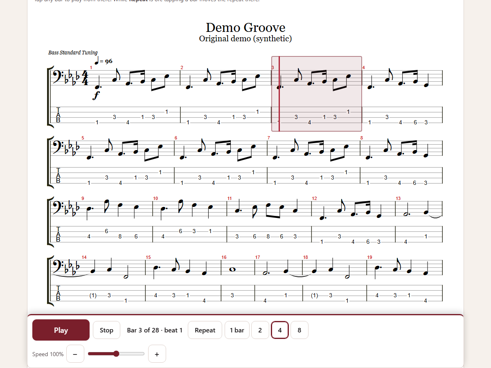
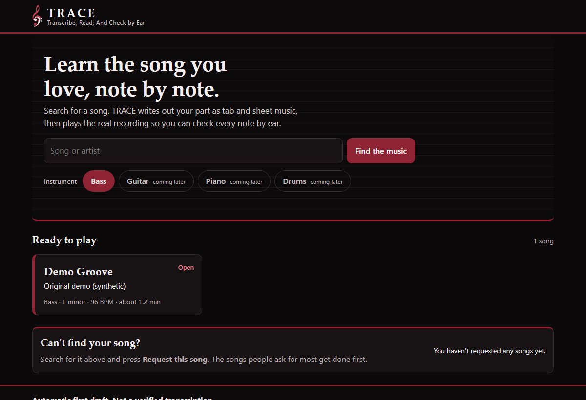
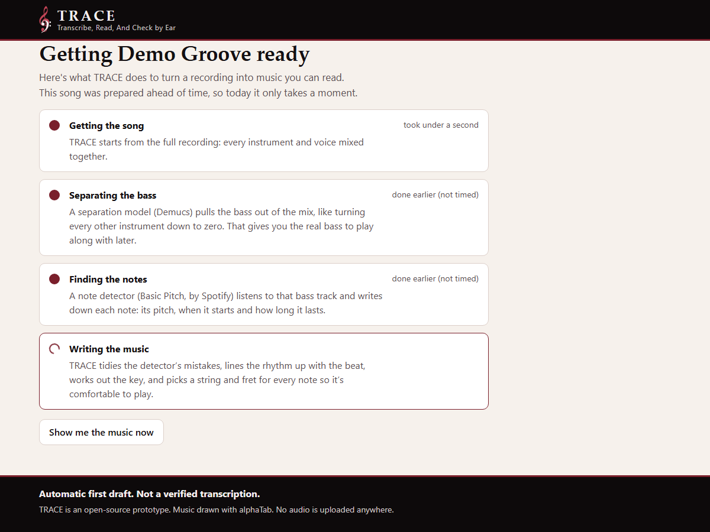
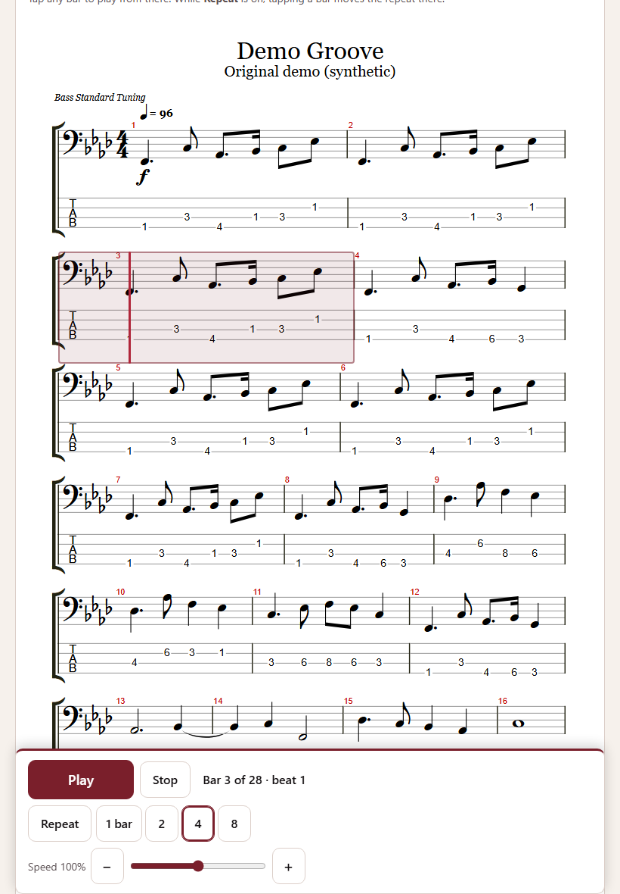
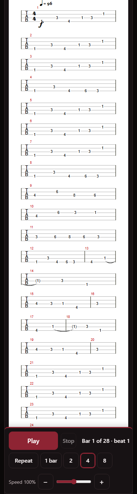

# TRACE: Transcribe, Read, And Check by Ear

**An open-source prototype that turns a song into bass tab and sheet music you can read, hear and print.**
It's for musicians who can't find sheet music for a song, or can't afford it. Bass comes first; other instruments could follow.

> Automatic first draft. Not a verified transcription.



This is a product-management case-study prototype. The code is kept plain and readable on purpose, so every decision can be explained. The design choices are written up in [docs/decisions.md](docs/decisions.md).

---

## How it works

```
song audio ──► separate the bass ──► find the notes ──► write the tab ──► web page
 (your file)   (Demucs, or StemKit    (Basic Pitch:       (pipeline/arrange.py:   (alphaTab: tab, sheet
                by hand: a bass stem)  MIDI out)           cleanup, rhythm, key,   music, playback,
                                                           ties, string & fret)    tracker, print)
```

| Step | What happens | Tool | Licence |
|---|---|---|---|
| 1. Get the song | You give it an audio file you have the right to use | – | – |
| 2. Separate the bass | Pull the bass out of the full mix | [Demucs](https://github.com/facebookresearch/demucs) (automatic), or a stem you made yourself | MIT |
| 3. Find the notes | Turn the bass audio into notes (MIDI) | [Basic Pitch](https://github.com/spotify/basic-pitch) by Spotify | Apache-2.0 |
| 4. Write the tab | Clean up the notes, snap the rhythm, guess the key, add ties, choose string and fret | `pipeline/arrange.py` (this repo) | MIT |
| Show it | Draw tab and sheet music, play it, follow along, print | [alphaTab](https://alphatab.net) | MPL-2.0 |

## The user journey

The journey follows a "ticket marketplace" pattern: you say what you want, quickly get a result page, and act on it. It's only a UX pattern; nothing is integrated with any marketplace or streaming service. More detail is in [docs/journey.md](docs/journey.md).

1. **Find**: search, or pick from the songs that are ready. If a song isn't there, you see "We don't have that yet" and a **Request this song** button. That button is a *fake door*: it counts demand before anything is built. Requests stay in your browser (localStorage), and you can export them as JSON.
2. **Wait**: while the song is prepared, the screen explains each of the four steps in plain words (get the song, separate the instrument, find the notes, write the music). In this prototype they ran ahead of time, and the screen says so. It shows how long each step **really** took when the song was built (from `build.json`). Steps that weren't timed say "done earlier (not timed)".
3. **See it**: the whole song as tab, sheet music, or both. The key is detected, shown, and can be changed.
4. **Hear it**: **Play** plays the real bass while a marker follows the tab. You can also play the tab alone, or both together. **Repeat** loops 1, 2, 4 or 8 bars from where you are; tap any bar to move the repeat there. If the marker runs ahead of or behind the sound (wireless headphones), nudge it under "Marker ahead of or behind the sound?".
5. **Take it away**: print, or save as PDF. Only the music is printed.

The page itself doesn't show these stages as a progress strip; they're the design model behind it. Only bass works today. The front page shows guitar, piano and drums as "coming later": tapping one records the interest, like **Request this song**.

| Find | Wait | Result (iPad) | Result (phone) |
|---|---|---|---|
|  |  |  |  |

Works on desktop, iPad (portrait and landscape) and phones. iPad layouts were checked in a desktop browser at iPad screen sizes, not yet on a real iPad.

### Why there are two sounds

- **The real bass** (the separated stem) is the bass player from the recording. It is the **answer key**.
- **The tab played back** is what the tool wrote down, played by a synthesized bass. It is **what the product produced**.

Hearing one against the other is how a person judges whether the tab is right. That's why the main **Play** button plays the real bass while the tracker follows the tab. **Hear the tab alone** plays the synthesized version, and **Play both** is there for side-by-side checking. The two are separate players, so over a long stretch they can drift apart slightly.

The tracker is driven by the real bass's playback clock: `beat = (currentTime − offset) × BPM / 60`. The BPM and the offset (the time of beat 1) are stored in the song's metadata.

---

## Run it

You need Python 3 (3.11 recommended) on Windows, macOS or Linux. There is no build step and nothing to install for the page.

```bash
cd web
```

```bash
python -m http.server 8000
```

Open http://localhost:8000. Opening `index.html` by double-clicking won't work, because the page loads files.

The public repo comes with one song, **Demo Groove**. It's an original bass line written for this project, so it is safe to publish (see [Demo song](#demo-song)).

## Run the tests

```bash
python -m venv .venv
```

```bash
.venv\Scripts\activate
```

```bash
pip install -r requirements.txt
```

```bash
python -m pytest
```

The tests cover grid snapping, cleanup, joining repeated notes, dotted note lengths, ties across barlines, "every bar adds up to 4/4", key detection (F minor, A♭ major, E minor), fingering, and tempo and beat-1 guesses. All inputs are small made-up note lists or the original demo song. No copyrighted material is used.

## Build a new song

Use only audio you have the right to use (see [Rights and licensing](#rights-and-licensing)).

**Option A: fully scripted (Demucs).** Install the full pipeline in a Python 3.11 environment:

```bash
pip install -r requirements-full.txt
```

```bash
python pipeline/build_song.py --audio my_song.wav --id my-song --title "My Song" --artist "Me" --bpm 83
```

**Option B: you make the bass stem yourself** (for example with StemKit, below), and the script does the rest:

```bash
python pipeline/build_song.py --stem my_bass.wav --id my-song --title "My Song" --artist "Me"
```

**Option C: you already have a MIDI file.** Note detection is skipped. Add `--stem` to get the "real bass" button:

```bash
python pipeline/build_song.py --midi bass.mid --stem my_bass.wav --id my-song --title "My Song"
```

The script prints the same four steps as the Wait screen and times each one. It writes `web/songs/<id>/song.atex`, the stem, and `build.json`, then adds the song to the list.

**Built songs are private by default.** They're listed in `web/songs/manifest.local.json`, and git ignores both that file and the song folder. Add `--public` only for material you may publish, such as your own music, public-domain music, or synthetic test material.

### Tempo and beat 1: guesses you should check

`--bpm` and `--offset` are optional. Leave them out and they are **guessed**, and the guess is printed with a confidence level and the other likely tempos:

```bash
python pipeline/tempo.py my_bass.mid
```

**Tempo detection can be wrong.** It often lands on half or double the real tempo, or on a nearby wrong one. On the first real song tried with this project, early estimates were 108 BPM and then 75 BPM; the real tempo was **83**. Always check by ear and pass `--bpm` yourself when you know it.

The beat-1 guess assumes the first bass note falls on beat 1. That can fail: on the first real song we checked, the first detected notes came before the first downbeat, so the guess was about 0.4 s early and every note landed 2–3 sixteenths late in the bar. Pitches were still right; the rhythm looked wrong. Check it by ear with the tracker: if the marker reaches beat 1 before you hear the downbeat, the offset is too early. Set `--offset` to the time of the first real beat 1.

### Cleanup settings

Every threshold can be changed on the command line (`--help` lists them):

| Setting | Default | What it does |
|---|---|---|
| `--min-velocity` | 20 | Drop notes quieter than this (0–127) |
| `--min-note-ms` | 50 | Drop notes shorter than this; they're almost always detector noise |
| `--merge-gap-ms` | 30 | Same pitch, gap shorter than this: one held note, not two |
| `--merge-short-fraction` | 0.5 | Fold notes shorter than half a 16th into the note before (slides, harmonics) |
| `--gap-fill` | 2 | Close silent gaps of up to two 16ths, so the page doesn't fill up with tiny rests |
| `--keep-repeats` | off | Don't join same-pitch notes that touch on the grid |

The defaults were chosen by ear on one song. Treat them as a starting point, not as tuned values.

### Making a bass stem by hand with StemKit (Windows)

[StemKit](https://github.com/danielravina/stemkit) is a free desktop app (MIT licence) for Windows 10/11 and macOS. It splits a song into stems (vocals, drums, bass, and more) on your own computer, using Demucs for the bass. It is a GUI app, not a Python library, so this repo doesn't import it, copy its code, or ship its binaries. The manual step is:

1. Run StemKit on a song you have the right to use, and export the **bass** stem as WAV.
2. Run `python pipeline/build_song.py --stem path\to\bass.wav --id ... --title ...`

Two things to know from StemKit's README:
- Its documented input is a **YouTube** link or search, not a local file. Its notes say: *"Downloading audio from YouTube violates their ToS for public products — keep this personal."* So StemKit is only appropriate for personal experiments. For audio files you own, use the Demucs route (Option A), which runs on local files.
- It uses Demucs for the bass, so Option A gives you a similar bass stem without leaving the script.

Demucs's original repository is MIT-licensed and now **archived** (no longer maintained by Meta). Its author maintains a fork at [adefossez/demucs](https://github.com/adefossez/demucs).

---

## Known limits

- **One note at a time.** Chords and double stops are reduced to the lowest note.
- **4/4 only, one tempo.** Songs with tempo or time-signature changes come out wrong after the change. Even one 2/4 bar shifts every later barline by half a bar (the notes are still right; they're just in the wrong bars).
- **Rhythm is snapped to 16th notes.** Triplets and swing are forced onto the straight grid.
- **Joining repeated notes is a trade-off.** A held note that the detector split in two is joined, which is right. But a bassist re-plucking the same note with no gap is also joined, which is wrong. On the demo song this joins 4 notes that were written as repeats (127 written, 123 shown). `--keep-repeats` and `--merge-gap-ms` control it.
- **Fingering is an algorithm** (it minimises hand movement and string jumps). It isn't always how a bassist would play it.
- **Key detection** looks at which notes are used and which notes land on beat 1. It reports a confidence level and you can override it, but modal or chromatic songs can fool it.
- **Tempo and beat 1 are guesses** (see above).
- **No accuracy number is claimed.** Accuracy against human transcriptions hasn't been measured yet. [docs/measurements.md](docs/measurements.md) is the template for recording it.
- **The demo song can't tell you how good Basic Pitch is.** Its "detected" MIDI is simulated (see below).

## Demo song

`pipeline/make_demo.py` writes **Demo Groove**, a 28-bar original bass line in F minor at 96 BPM:
- `demo/demo-groove-truth.mid`: the line as written (the answer key)
- `demo/demo-groove-detected.mid`: the same line with typical detector mistakes **added on purpose**: timing wobble, held notes split in two, short octave glitches and quiet ghost notes (168 notes instead of 127)
- `demo/demo-groove-stem.wav`: the line played by a simple synthesized bass, standing in for a separated stem

After cleanup, the tab built from the messy file is identical, bar for bar, to the tab built from the clean original. A test checks this (`test_demo_song_messy_midi_gives_same_tab_as_clean_original`). This only shows that the cleanup handles the kinds of mistakes we simulated. It says nothing about real recordings.

Rebuild it:

```bash
python pipeline/make_demo.py
```

```bash
python pipeline/build_song.py --midi demo/demo-groove-detected.mid --stem demo/demo-groove-stem.wav --id demo-groove --title "Demo Groove" --artist "Original demo (synthetic)" --bpm 96 --offset 1.0 --public
```

## Rights and licensing

*This is not legal advice. These are the guardrails this repo follows, plus the open business questions a real product would have to answer.*

**What this repo does:**
- It commits **no copyrighted audio, stems, MIDI or transcriptions of real songs**. `.gitignore` blocks all audio and MIDI files, built songs, `private-demo/` and `reference/`. The only exception is the original demo song.
- Songs you build are **private by default** (`manifest.local.json`, git-ignored).
- The page uploads nothing. Everything runs in your browser from local files.

**Open business questions for a real product:**
- **Tab and sheet music of a song are based on the song's composition.** Transcribing a copyrighted song and publishing the tab or sheet music generally needs a licence from the music publisher, even when the transcription is new. Sheet-music and tab sites operate under publisher licensing deals. Which model fits: per-song licences, a catalogue deal, or revenue share?
- **Where the audio comes from.** Downloading audio from YouTube or Spotify breaks their terms of service for a public product, and StemKit's own README says to keep YouTube downloads personal. Realistic options:
  1. **User-uploaded audio**, processed only for that user (like a personal practice tool), with no sharing of the result. This has the lowest rights exposure, but no shared catalogue.
  2. **Licensed catalogue deals**, where songs are processed once and served to everyone. This needs publisher (and possibly label) agreements.
- **The "Request this song" fake door** measures demand. It could also tell you which publishers to approach first.
- **Model licences.** Demucs (MIT) and Basic Pitch (Apache-2.0) both allow commercial use, but check the licences of the model weights and training data before shipping.

## Repo layout

```
README.md, LICENSE, .gitignore, requirements*.txt
web/                  the page (no build step)
  index.html, app.js, styles.css
  alphatab/           alphaTab library, Bravura font, Sonivox sound font (their own licences)
  songs/manifest.json         public song list (the demo)
  songs/manifest.local.json   your private songs (git-ignored)
  songs/<id>/                 song.atex, stem audio, build.json
pipeline/
  separate.py         step 2: "manual" (your stem) or "demucs"
  detect.py           step 3: Basic Pitch -> MIDI
  arrange.py          step 4: cleanup, grid, key, ties, fingering -> alphaTex
  tempo.py            tempo and beat-1 guesses with confidence
  build_song.py       one command: audio/stem/MIDI -> web/songs/<id>/
  make_demo.py        writes the original demo song
demo/                 the demo song's MIDI (original material)
tests/                unit tests (synthetic data only)
docs/                 decisions, journey, measurements template, screenshots
```

Why the song list lives in `web/songs/` and not in a top-level `songs/` folder: the page is served from `web/` with `python -m http.server`, and a static server can't reach files outside the folder it serves.

## Credits

- [alphaTab](https://alphatab.net) by Daniel Kuschny and contributors (MPL-2.0) draws and plays the music.
- [Basic Pitch](https://github.com/spotify/basic-pitch) by Spotify (Apache-2.0) finds the notes.
- [Demucs](https://github.com/facebookresearch/demucs) by Meta AI (MIT) separates the bass.
- The Bravura font (SIL OFL 1.1) and the Sonivox sound font (Apache-2.0) are used for drawing and playback.
