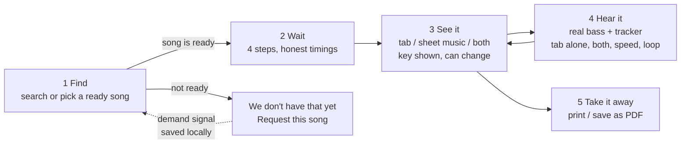
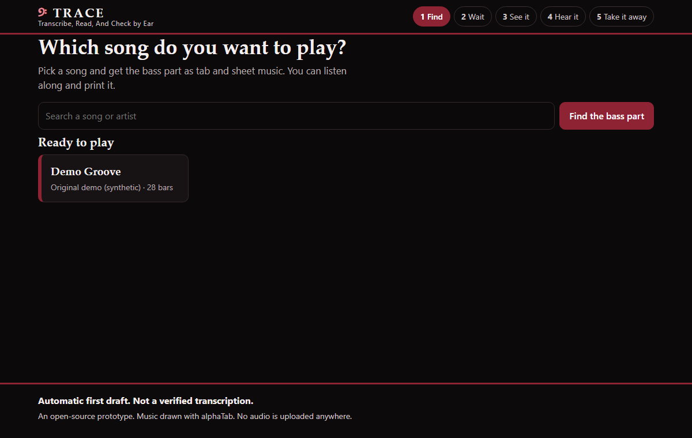
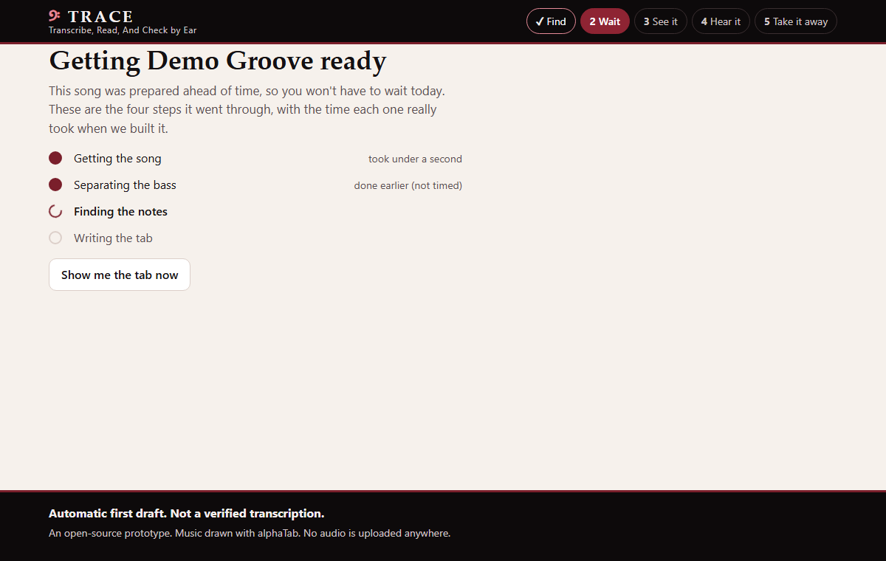
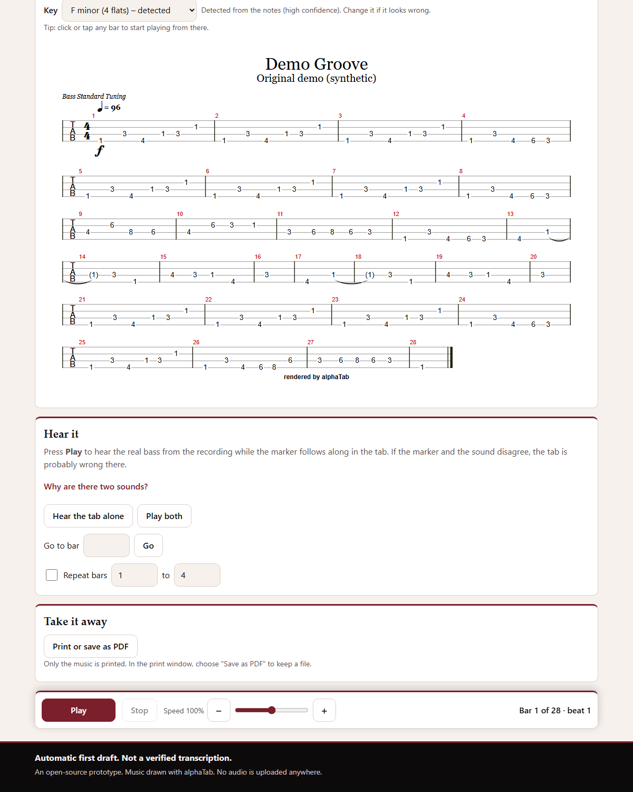
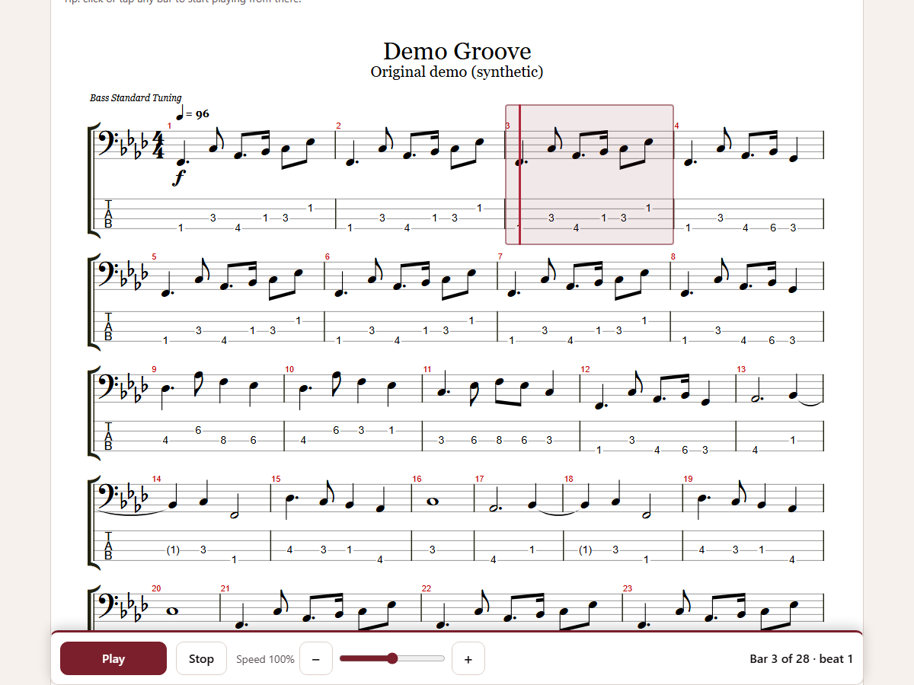

# User journey

The pattern is borrowed from ticket marketplaces: **say what you want → get a result page fast → act on it.** Nothing here integrates with any marketplace, streaming or video service.

| Stage | What the person wants | What the page does | What we learn |
|---|---|---|---|
| 1 Find | "Do you have my song?" | Search plus a list of ready songs. Unknown songs get **Request this song**. | Which songs people want (fake-door demand) |
| 2 Wait | "Is it working? How long?" | Four named steps. In the prototype they ran ahead of time, and the page says so, with the real timings from the build. | How long a real build takes per step |
| 3 See it | "Can I read this?" | The whole song, in tab, sheet music or both. Detected key with an override. | Which view people pick |
| 4 Hear it | "Is it right?" | The real bass plays and a marker follows the tab. Hear the tab alone, play both, change speed (50–150%), click a bar to jump, repeat bars. | Whether people can spot wrong notes by ear |
| 5 Take it away | "I want it on my music stand" | Print or save as PDF, with only the music. | Whether the draft is good enough to keep |

## Screens

| | |
|---|---|
|  |  |
|  |  |
